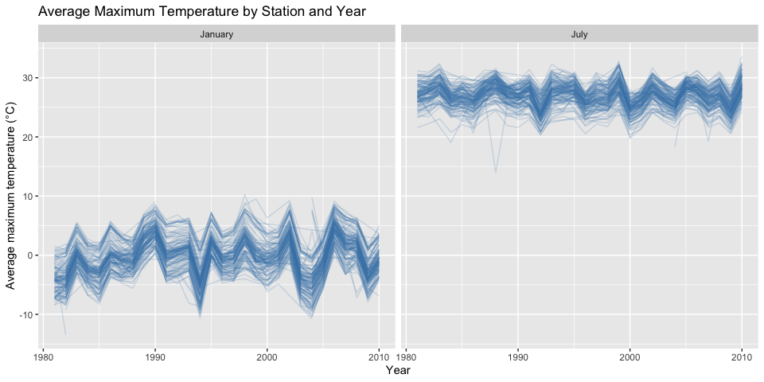
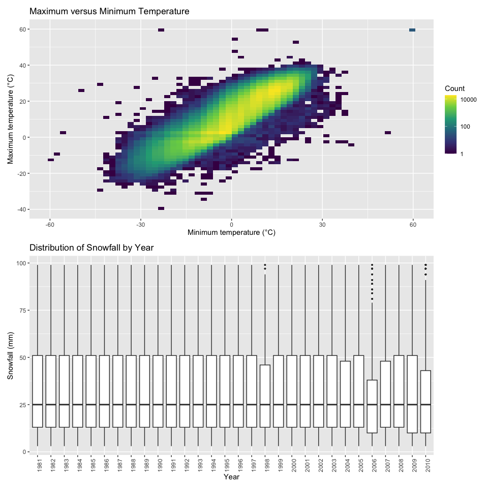
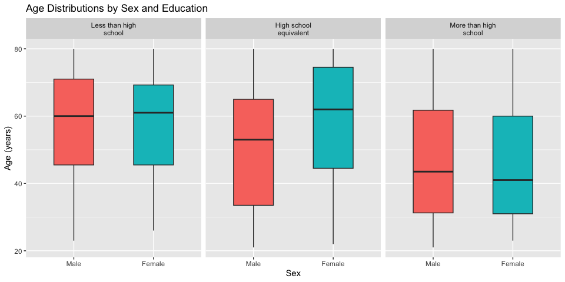
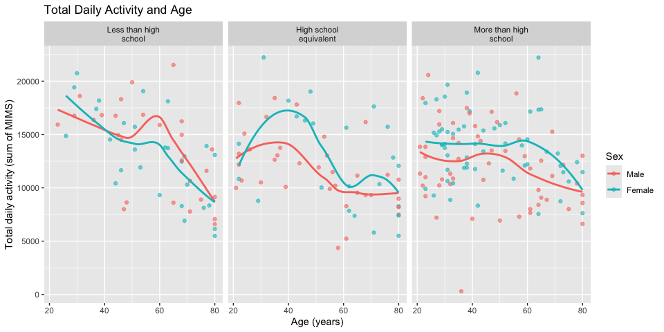
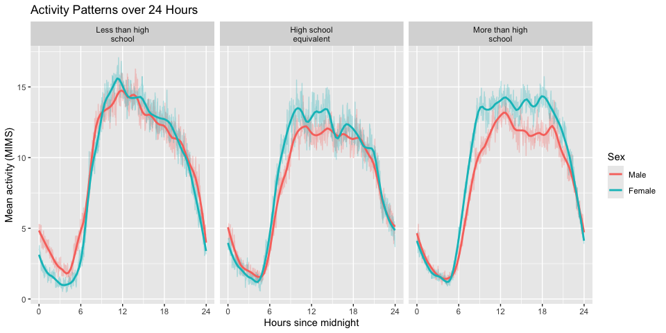

p8105_hw3_lc4152
================

``` r
library(tidyverse)
```

    ## ── Attaching core tidyverse packages ──────────────────────── tidyverse 2.0.0 ──
    ## ✔ dplyr     1.2.1     ✔ readr     2.2.0
    ## ✔ forcats   1.0.1     ✔ stringr   1.6.0
    ## ✔ ggplot2   4.0.3     ✔ tibble    3.3.1
    ## ✔ lubridate 1.9.5     ✔ tidyr     1.3.2
    ## ✔ purrr     1.2.2     
    ## ── Conflicts ────────────────────────────────────────── tidyverse_conflicts() ──
    ## ✖ dplyr::filter() masks stats::filter()
    ## ✖ dplyr::lag()    masks stats::lag()
    ## ℹ Use the conflicted package (<http://conflicted.r-lib.org/>) to force all conflicts to become errors

``` r
library(patchwork)
library(p8105.datasets)
```

## Problem 1

### Data cleaning and description

``` r
data("ny_noaa")

noaa_df =
  ny_noaa |>
  mutate(
    year = lubridate::year(date),
    month = lubridate::month(date),
    day = lubridate::day(date),
    tmax = as.numeric(tmax) / 10,
    tmin = as.numeric(tmin) / 10,
    prcp = prcp / 10
  )
```

The original dataset contains 2595176 observations and 7 variables from
747 weather stations in New York. Each observation represents weather
measurements for one station on one date. The data include
precipitation, snowfall, snow depth, and maximum and minimum
temperatures.

``` r
noaa_df |>
  summarise(
    across(
      c(prcp, snow, snwd, tmax, tmin),
      ~ mean(is.na(.x)) * 100
    )
  ) |>
  pivot_longer(
    everything(),
    names_to = "variable",
    values_to = "missing_percent"
  ) |>
  knitr::kable(
    digits = 1,
    col.names = c("Variable", "Missing (%)")
  )
```

| Variable | Missing (%) |
|:---------|------------:|
| prcp     |         5.6 |
| snow     |        14.7 |
| snwd     |        22.8 |
| tmax     |        43.7 |
| tmin     |        43.7 |

Both maximum and minimum temperatures are missing for 43.7% of
observations. Snow depth is missing for 22.8%, snowfall for 14.7%, and
precipitation for 5.6%. Therefore, summaries and plots based on observed
values may not fully represent all stations and dates.

### Most common snowfall values

``` r
noaa_df |>
  filter(!is.na(snow)) |>
  count(snow, sort = TRUE) |>
  slice_head(n = 10) |>
  knitr::kable(
    col.names = c("Snowfall (mm)", "Number of observations")
  )
```

| Snowfall (mm) | Number of observations |
|--------------:|-----------------------:|
|             0 |                2008508 |
|            25 |                  31022 |
|            13 |                  23095 |
|            51 |                  18274 |
|            76 |                  10173 |
|             8 |                   9962 |
|             5 |                   9748 |
|            38 |                   9197 |
|             3 |                   8790 |
|           102 |                   6552 |

The most common snowfall value is 0 mm, with 2,008,508 observations,
because most station-days have no snowfall. Other common values include
25, 13, and 51 mm. These values are approximately 1, 0.5, and 2 inches,
suggesting that measurements originally recorded in inches were
converted to millimeters and rounded.

### Average maximum temperature in January and July

``` r
noaa_monthly =
  noaa_df |>
  filter(month %in% c(1, 7)) |>
  group_by(id, year, month) |>
  summarise(
    mean_tmax = mean(tmax, na.rm = TRUE),
    .groups = "drop"
  ) |>
  filter(!is.na(mean_tmax)) |>
  mutate(
    month = factor(
      month,
      levels = c(1, 7),
      labels = c("January", "July")
    )
  )

noaa_monthly |>
  ggplot(aes(x = year, y = mean_tmax, group = id)) +
  geom_line(alpha = 0.2, color = "steelblue") +
  facet_wrap(~ month) +
  labs(
    title = "Average Maximum Temperature by Station and Year",
    x = "Year",
    y = "Average maximum temperature (°C)"
  )
```

<!-- -->
Average maximum temperatures are much higher in July than in January.
January also shows larger year-to-year fluctuations. Many stations
follow similar patterns across years, suggesting shared regional weather
patterns. There are some possible outliers, including a July average
near 14°C around 1988, well below the other stations. Unusual values may
reflect local conditions, incomplete observations, or recording errors
and would require further investigation.

### Temperature relationship and snowfall distributions

``` r
temp_plot =
  noaa_df |>
  filter(!is.na(tmax), !is.na(tmin)) |>
  ggplot(aes(x = tmin, y = tmax)) +
  geom_bin_2d(bins = 60) +
  scale_fill_viridis_c(trans = "log10") +
  labs(
    title = "Maximum versus Minimum Temperature",
    x = "Minimum temperature (°C)",
    y = "Maximum temperature (°C)",
    fill = "Count"
  )

snow_plot =
  noaa_df |>
  filter(snow > 0, snow < 100) |>
  ggplot(aes(x = factor(year), y = snow)) +
  geom_boxplot(outlier.size = 0.5) +
  labs(
    title = "Distribution of Snowfall by Year",
    x = "Year",
    y = "Snowfall (mm)"
  ) +
  theme(
    axis.text.x = element_text(angle = 90, hjust = 1)
  )

temp_plot / snow_plot
```

<!-- -->
Maximum and minimum temperatures show a strong positive relationship:
days with higher minimum temperatures generally also have higher maximum
temperatures. A few observations have extreme temperatures, and some
appear to have maximum temperatures below minimum temperatures,
suggesting possible recording errors.

For snowfall values greater than 0 and less than 100 mm, the
distributions are similar across years. The median is approximately 25
mm in each year, and the middle 50% of observations generally fall
between about 13 and 51 mm. Some years, such as 2006, have a smaller
interquartile range. There is no clear long-term trend in these
conditional snowfall distributions.

## Problem 2

### Import and clean the data

``` r
covar_df =
  read_csv("data/nhanes_covar.csv", skip = 4) |>
  janitor::clean_names() |>
  filter(age >= 21) |>
  drop_na(sex, age, bmi, education) |>
  mutate(
    sex = factor(
      sex,
      levels = c(1, 2),
      labels = c("Male", "Female")
    ),
    education = factor(
      education,
      levels = c(1, 2, 3),
      labels = c(
        "Less than high school",
        "High school equivalent",
        "More than high school"
      )
    )
  )
```

    ## Rows: 250 Columns: 5
    ## ── Column specification ────────────────────────────────────────────────────────
    ## Delimiter: ","
    ## dbl (5): SEQN, sex, age, BMI, education
    ## 
    ## ℹ Use `spec()` to retrieve the full column specification for this data.
    ## ℹ Specify the column types or set `show_col_types = FALSE` to quiet this message.

``` r
accel_df =
  read_csv("data/nhanes_accel.csv") |>
  janitor::clean_names()
```

    ## Rows: 250 Columns: 1441
    ## ── Column specification ────────────────────────────────────────────────────────
    ## Delimiter: ","
    ## dbl (1441): SEQN, min1, min2, min3, min4, min5, min6, min7, min8, min9, min1...
    ## 
    ## ℹ Use `spec()` to retrieve the full column specification for this data.
    ## ℹ Specify the column types or set `show_col_types = FALSE` to quiet this message.

``` r
nhanes_df =
  covar_df |>
  left_join(accel_df, by = "seqn") |>
  pivot_longer(
    starts_with("min"),
    names_to = "minute",
    names_prefix = "min",
    values_to = "mims"
  ) |>
  mutate(
    minute = as.integer(minute),
    hour = (minute - 1) / 60
  )
```

Participants younger than 21 years and those with missing demographic
data were excluded. Sex and education were converted to factors with
descriptive labels. The demographic and activity datasets were merged
using participant ID. Minute-level activity measurements were then
converted from wide to long format, retaining all original demographic
variables.

The cleaned dataset includes 228 participants. Each row of the merged,
tidy dataset represents one minute for one participant. Minute 1
corresponds to midnight.

### Number of participants by sex and education

``` r
covar_df |>
  count(education, sex) |>
  pivot_wider(
    names_from = sex,
    values_from = n,
    values_fill = 0
  ) |>
  knitr::kable(
    col.names = c("Education", "Male", "Female")
  )
```

| Education              | Male | Female |
|:-----------------------|-----:|-------:|
| Less than high school  |   27 |     28 |
| High school equivalent |   35 |     23 |
| More than high school  |   56 |     59 |

The more than high school group has the most participants, with 56 men
and 59 women. The less than high school group has similar numbers of men
and women (27 and 28), while the high school equivalent group has more
men than women (35 versus 23).

### Age distributions by sex and education

``` r
covar_df |>
  ggplot(aes(x = sex, y = age, fill = sex)) +
  geom_boxplot(width = 0.5) +
  facet_wrap(
    ~ education,
    labeller = label_wrap_gen(width = 20)
  ) +
  labs(
    title = "Age Distributions by Sex and Education",
    x = "Sex",
    y = "Age (years)"
  ) +
  guides(fill = "none")
```

<!-- -->
Participants with more than high school education are generally younger,
with median ages of approximately 44 for men and 41 for women. In the
less than high school group, men and women have similar age
distributions, with medians around 60. In the high school equivalent
group, women have a higher median age than men, approximately 62 versus
53. However, age distributions overlap substantially across groups.

### Total daily activity and age

``` r
activity_total =
  nhanes_df |>
  group_by(seqn, sex, age, bmi, education) |>
  summarise(
    total_activity = sum(mims),
    .groups = "drop"
  )

activity_total |>
  ggplot(aes(x = age, y = total_activity, color = sex)) +
  geom_point(alpha = 0.6) +
  geom_smooth(method = "loess", se = FALSE) +
  facet_wrap(
    ~ education,
    labeller = label_wrap_gen(width = 20)
  ) +
  labs(
    title = "Total Daily Activity and Age",
    x = "Age (years)",
    y = "Total daily activity (sum of MIMS)",
    color = "Sex"
  )
```

    ## `geom_smooth()` using formula = 'y ~ x'

<!-- -->
Total daily activity generally decreases with age across all three
education groups, although the relationships are not strictly linear. In
the less than high school group, men tend to have higher fitted activity
levels during middle age. In the high school equivalent group, women
have higher fitted activity levels around ages 30–50. In the more than
high school group, women generally have higher fitted activity levels
across most ages. There is considerable individual variation, and these
descriptive patterns do not establish causal relationships. \###
Activity patterns over 24 hours

``` r
activity_time =
  nhanes_df |>
  group_by(education, sex, minute, hour) |>
  summarise(
    mean_mims = mean(mims),
    .groups = "drop"
  )

activity_time |>
  ggplot(aes(x = hour, y = mean_mims, color = sex)) +
  geom_line(alpha = 0.3) +
  geom_smooth(
    method = "loess",
    span = 0.15,
    se = FALSE
  ) +
  facet_wrap(
    ~ education,
    labeller = label_wrap_gen(width = 20)
  ) +
  scale_x_continuous(
    breaks = c(0, 6, 12, 18, 24),
    limits = c(0, 24)
  ) +
  labs(
    title = "Activity Patterns over 24 Hours",
    x = "Hours since midnight",
    y = "Mean activity (MIMS)",
    color = "Sex"
  )
```

    ## `geom_smooth()` using formula = 'y ~ x'

<!-- -->
All three education groups show low activity overnight, a sharp increase
in the morning, higher activity during the day, and a decline in the
evening. In the less than high school group, activity peaks around late
morning, and men and women have similar daytime patterns. In the high
school equivalent group, women generally have higher activity during the
late morning and early afternoon. The more than high school group shows
a clearer sex difference, with women having higher average activity
throughout most daytime hours. These comparisons are descriptive and may
partly reflect differences in age across groups.

## Problem 3
